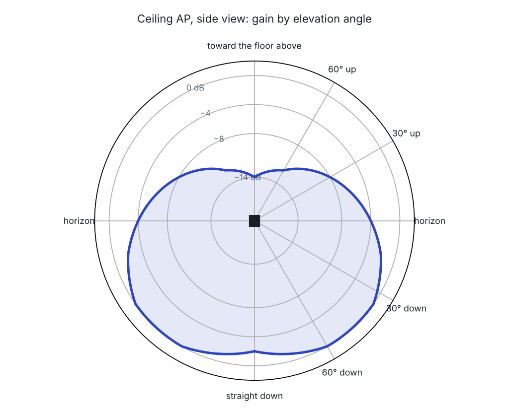

I'm upgrading my network to two ceiling-mounted Wi-Fi 7 access points, one per floor, so I wanted to plot where they should go before cutting any drywall. My first idea was to use AI to pull my house's layout from government sites, but the detail wasn't good enough. So instead I used the map data from my two robot vacuums, which have been LiDAR-mapping the house for years. A tape measure fixed the few distances that were off, and I approximated the wall thicknesses.

From there I accounted for the wave shape of the AP's signal, walls, floors, beams and areas of interest, like the couch, a desk and the bed. The wave shape matters more than I expected. A ceiling AP throws signal down and out, strongest 30 to 60 degrees below the ceiling and weak straight back up, so an AP downstairs does very little for the room above it.

{: width="70%" }

The model tries every pair of ceiling spots and scores how well each covers the house. The winner was one AP per floor, roughly stacked near the middle of the house, which is also an easy cable run. I'll check it against real readings once the APs are up.

Above you can use the app for yourself, or use this page to guide your AI to do the same.


## How the model works

For each point (a phone held 3½ ft off the floor), the planner traces a straight path from each AP and sums log-distance path loss (exponent 2.1), a loss for each wall face crossed (up to 2.5× more at shallow angles), the floor between levels, an optional ceiling beam, the antenna pattern, and 3 dB for a hand.

| Obstacle (5 GHz) | Loss |
|---|---|
| Interior wall | 2 dB per face |
| Bathroom wall | 3 dB per face |
| Garage wall | 3.5 dB per face |
| Exterior wall | 5 dB per face |
| Floor between levels | 14 dB |

2.4 GHz loses less through everything, 6 GHz more. Each point on a 12-inch grid scores 0 at −72 dBm to 1 at −55 dBm, averaged over 5 and 6 GHz and weighted by room type (offices 1.5, living rooms 1.2, bedrooms and kitchens 1, baths 0.4, garages 0.2). The search scores every pair of ceiling spots on a 2 ft grid, then polishes the winner on a 1 ft grid. It takes a second or two in the browser.

```javascript
function pathLoss(ap, px, py, pz) {
  const dx = px - ap.x, dy = py - ap.y, dz = pz - ap.z;
  const d = Math.hypot(dx, dy, dz), dm = Math.max(d * 0.0254, 0.5);  // inches -> meters
  let walls = 0;
  for (const w of faces) {                    // every wall face, both floors
    const t = crossing(ap, px, py, w);        // where the 2D path crosses it, or -1
    if (t < 0) continue;
    const z = ap.z + t * dz;
    if (z < w.z0 || z > w.z1) continue;       // went over or under it
    const cos = Math.abs((w.nx * dx + w.ny * dy) / d);
    walls += FACE[w.type] * Math.min(1 / cos, 2.5);
  }
  walls += slabLoss(ap, px, py, pz) + beamLoss(ap, px, py, pz);
  const gain = pattern(Math.asin(dz / d) * 180 / Math.PI);
  return EIRP + gain - (fspl1m + 21 * Math.log10(dm)) - walls - 3;
}
```
